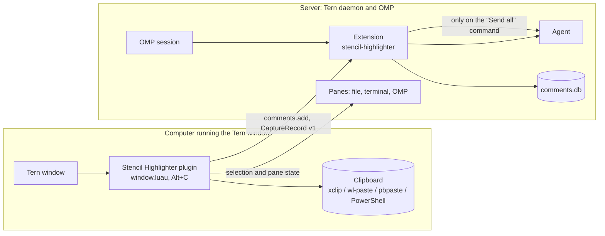
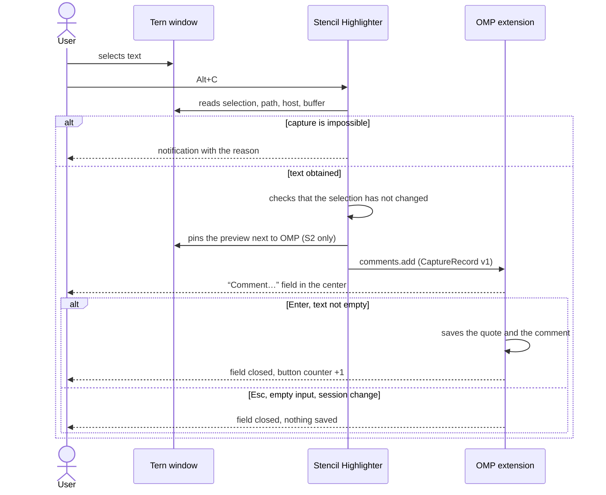
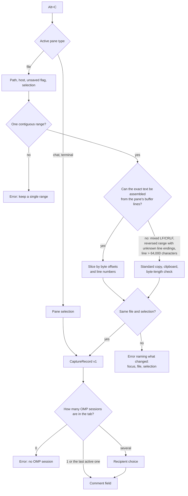
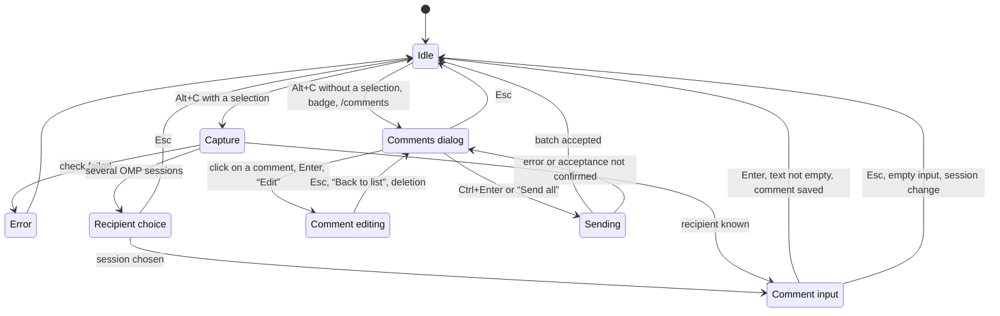

# Stencil Highlighter — schematic design specification

| Status                       | Tern   | OMP     |
| ---------------------------- | ------ | ------- |
| Implementation specification | 0.9.12 | 18.18.3 |

Stencil Highlighter adds a comment to a selection in Tern and passes it to the OMP extension. The OMP extension is part of this repository. Its Comments dialog is a standard SDK overlay with files on the left and comments in the center. Editing happens in a separate full-size sheet.

## 1. Problem

The user reads a file, terminal output or an agent reply. They want to leave a remark about a specific place. They select text, press the capture shortcut, write a comment and carry on working. Comments accumulate in the Comments dialog. They go to the agent as one batch, and only on an explicit user command. Section 9 lists the keys.

The success criterion has two parts. Getting from a selection to a saved comment takes one shortcut, one text entry and Enter. The quote and the file location match what the user selected.

## 2. Invariants

| No. | Rule                                                                                             | Why                                                                                 |
| --- | ------------------------------------------------------------------------------------------------ | ----------------------------------------------------------------------------------- |
| I1  | The quote is the exact selected text; for a file, the path and lines are given if they are known | Without the location, the agent cannot identify the commented place                 |
| I2  | A remote file is never re-read by path on the computer running the window                        | A local path may point to a different file                                          |
| I3  | An unsaved buffer is the source of truth; a batch attribute marks that the file is not saved     | The user comments on what they see                                                  |
| I4  | Nothing is stored before Enter                                                                   | Escape must not leave garbage behind                                                |
| I5  | Nothing is sent to the agent automatically                                                       | Sending is a separate user decision                                                 |
| I6  | The draft in the OMP input field is not changed                                                  | A comment must not spoil a message the user has started                             |
| I7  | Invented text is never saved; on any doubt, capture aborts with a clear reason                   | An error is better than a wrong quote                                               |
| I8  | Only standard Tern components and tokens; not a single custom color value                        | Colors come from the active theme and the system contrast and transparency settings |

## 3. Components and placement



| Component                  | Runs on                              | Responsibility                                                                                      |
| -------------------------- | ------------------------------------ | --------------------------------------------------------------------------------------------------- |
| Stencil Highlighter plugin | The computer running the Tern window | The only component with access to the selection, the focus and the window layout                    |
| OMP extension              | The OMP host                         | Stores comments, shows the input field and the Comments dialog, and builds the message to the agent |

The plugin reaches the OMP extension through an event. The event goes to the extension's Comments button in the OMP input line of the same tab.

| Link    | Value            |
| ------- | ---------------- |
| Event   | `comments.add`   |
| Payload | CaptureRecord v1 |

## 4. Scenarios

| No. | Scenario                        | Source                                        | Expected result                                              |
| --- | ------------------------------- | --------------------------------------------- | ------------------------------------------------------------ |
| S1  | Comment on code in an open file | File, source text mode                        | Quote, path, lines `:10-14`, language                        |
| S2  | Comment from a file preview     | Pop-up preview                                | As S1; the preview is pinned next to OMP                     |
| S3  | Comment on rendered Markdown    | File, `rendered` mode                         | Source text of the selection with line numbers, per D1       |
| S4  | Comment on command output       | Terminal                                      | Quote and working directory                                  |
| S5  | Comment on a chat selection     | OMP chat                                      | Exact rendered quote; no guessing of the author              |
| S6  | Viewing and editing comments    | Badge, `/comments`, Alt+C without a selection | Existing Comments dialog                                     |
| S7  | Sending a batch                 | Comments dialog                               | One message to the agent; if the agent is busy, it is queued |
| S8  | Capture is impossible           | Any                                           | Notification with a specific reason; no comment              |

## 5. Main flow

The wireframes show layout, not color. The active Tern theme sets the colors. Each annotation names the SDK token or standard component that styles the element.

**Frame 1. Selection.** The user selects text in a file, preview, terminal or chat.

```text
┌─ OMP ─────────────────────┬─ window.luau ─────────────────────────┐
│ …agent reply…             │  9  local function run(cx)            │
│                           │ 10  ░░local session = cx.session░░░░░ │  ░ selection (--tv-sel)
│                           │ 11  ░░░░if not session then░░         │
│                           │ 12      return                        │
│ ╭───────────────────────╮ │                                       │
│ │ draft…           [✉ 2]│ │                                       │  [✉ 2] Comments badge
│ ╰───────────────────────╯ │                                       │  (omp.btn button, neutral tone)
└───────────────────────────┴───────────────────────────────────────┘
```

**Frame 2. Capture.** Stencil Highlighter captures the text and the source. For a preview, the plugin pins the same block to the right of OMP. This step has no visible interface.

**Frame 3. Comment field.** A standard Tern overlay without a title opens in the center of the window. The key legend under the wireframe is for the reader of this specification. The screen shows no hint.

```text
┌───────────────────────────────────────────────────────────────────┐
│                        (Tern overlay scrim)                       │
│                                                                   │
│          ╭──────────────────────────────────────────────╮         │  overlay card:
│          │ │Comment…                                    │         │  background and ring — Tern
│          │                                              │         │  placeholder (--t4)
│          ╰──────────────────────────────────────────────╯         │  caret (--tv-cur, else --accent)
│                                                                   │
└───────────────────────────────────────────────────────────────────┘
   Enter — save · Shift+Enter — new line · Esc — cancel
```

**Frame 4. Saved.** The field closes, and focus returns. The badge counter goes up by one.

```text
[✉ 2] → [✉ 3]
```



## 6. Selection capture



Capture reads the text from the buffer lines of the active pane. These lines are the source text, including unsaved edits and remote files. Capture does not read the editor accessibility tree. That path requires a focused editor node. Rendered Markdown uses a different field and has no such node, so capture through the accessibility tree always fails there. In large files, the node holds only the visible chunk, not the start of the file.

A selected file pane can leave the tab focus on OMP. If the active chat has no selection, the plugin searches the tab for a single selected file pane. It focuses that pane through the SDK before capture. The search excludes other tabs and parked or terminated panes. Several selected files are not resolved by guessing.

## 7. States



A new valid capture closes the Comments dialog or its detail sheet and keeps the current edits. It then opens input for a new comment. An invalid or already saved capture does not close the dialog.

A repeated capture while the comment field is open does not open a second field. It keeps the unsaved input of the open field. Tern shows an information notification instead. A repeated capture that still reaches OMP while the field is open gets a warning.

| Message                           | Text                                                             |
| --------------------------------- | ---------------------------------------------------------------- |
| Information on a repeated capture | Finish the current comment, second line Enter saves, Esc cancels |
| Warning on a repeated capture     | Finish the current comment: Enter saves, Esc cancels             |

## 8. Errors and texts

A capture error appears as a standard Tern notification at the bottom center of the window.

```text
                 ╭──────────────────────────────────────────────╮
                 │ ⚠  Could not read the selection              │  error icon and tone (--bad)
                 │    The selection changed during capture.     │  mono detail line
                 │    Press Alt+C again                         │
                 ╰──────────────────────────────────────────────╯
```

Capture check errors share one notification title. Hand-off errors have their own titles. The second line states one reason and one action. The plugin log records the same reason as a warning. Every file-capture failure also carries a stable reason code, which the tests check instead of the text.

| Part                                | Text                                        |
| ----------------------------------- | ------------------------------------------- |
| Title of every capture check error  | Could not read the selection                |
| Title of a failed hand-off          | Could not pass the selection to the session |
| Title of a failed Comments hand-off | Could not open Comments                     |

| Reason               | Code                  | Check                                                                                        | Title                                                   | Second line                                                                                                                             |
| -------------------- | --------------------- | -------------------------------------------------------------------------------------------- | ------------------------------------------------------- | --------------------------------------------------------------------------------------------------------------------------------------- |
| Several ranges       | `several-selections`  | more than one range is selected in the file, at the start or during capture                  | Could not read the selection                            | Make one continuous selection                                                                                                           |
| Focus moved          | `focus-left`          | the active pane is no longer the source file                                                 | Could not read the selection                            | Focus left the file. Return to it and press Alt+C again                                                                                 |
| File changed         | `file-switched`       | different path or host                                                                       | Could not read the selection                            | The pane shows a different file now. Make the selection again                                                                           |
| Buffer changed       | `file-changed`        | the byte size, line count or unsaved flag changed                                            | Could not read the selection                            | The file changed during capture. Press Alt+C again                                                                                      |
| Selection moved      | `selection-changed`   | the bounds changed                                                                           | Could not read the selection                            | The selection changed during capture. Press Alt+C again                                                                                 |
| No clipboard program | `no-clipboard-reader` | the fallback path is needed, but `xclip` / `wl-paste` / `pbpaste` / PowerShell was not found | Could not read the selection                            | No clipboard reader found. Install pbpaste (macOS), wl-paste (Wayland), xclip (X11) or PowerShell (Windows). The clipboard is unchanged |
| Wrong text copied    | `copy-mismatch`       | the byte length of the copied text does not equal the selected range                         | Could not read the selection                            | The copied text does not match the selection. The selection was not added                                                               |
| Internal error       | `internal`            | Tern API exception during a recheck of the clipboard fallback                                | Could not read the selection                            | Internal capture error: ‹exception text›                                                                                                |
| Pane closed          | none                  | the preview closed before hand-off                                                           | Could not pass the selection to the session             | The source file is no longer available in this tab                                                                                      |
| No OMP session       | none                  | the tab has no session with the OMP extension                                                | No OMP session available in this tab                    | Open OMP with the stencil-highlighter extension                                                                                         |
| No Comments button   | none                  | the session has no Comments button                                                           | Stencil Highlighter extension not found in this session | Open OMP with the stencil-highlighter extension and press Alt+C again                                                                   |

The Comments dialog is a standard SDK overlay with two identical lists. The left list shows files with counters. The center list shows exactly one row per comment. Each row holds the comment text and the file location, without a second quote line. The shared list primitive gives both lists the same row heights and top padding. There is no separate vertical divider. One file entry groups all of its ranges. Files with identical names are distinguished by path. Remote hosts are not mixed with local ones. Terminal and chat are separate sources. The all-sources entry shows the whole batch. When the width is insufficient, the SDK wraps the columns.

Clicking a comment opens the detail sheet, a full-size modal SDK overlay. Enter and the edit action open it too. The sheet has a header row with the location and an Esc keycap, then the quote, then the comment editor, then a footer bar with the delete control. The terminal fallback uses the same quote-first order. Focus stays on the editor. The sheet has no quote, comment or new-line labels. The editor has a three-line minimum and scrolls after eight lines.

A saved local file up to 1 MiB gets context lines. After an unambiguous check of the exact quote, the sheet shows two lines before and after the range. The SDK code marks highlight the marked lines. A modified, unsaved, remote, clipped or unavailable source shows only the exact saved quote. The context changes neither storage nor sending.

Comment changes save automatically. Esc and the back-to-list action return to the previous file. Deleting a comment selects the next comment of the same file filter. Deleting the last comment of a file removes the file from the navigation. The send-all action exists only in the Comments dialog and sends the whole batch.

| Element                      | Literal                   |
| ---------------------------- | ------------------------- |
| Comments dialog lists        | `list/item`               |
| Detail sheet                 | `overlay`, `size: "full"` |
| Location row example         | `audit.md:9`              |
| Marked line highlighting     | `code.marks`              |
| All-sources entry            | All sources               |
| Edit action                  | Edit                      |
| Back-to-list action          | Back to list              |
| Send-all action              | Send all                  |
| Labels absent from the sheet | Quote, Comment, new line  |

## 9. Keyboard

| Where                | Key                                   | Action                                                               |
| -------------------- | ------------------------------------- | -------------------------------------------------------------------- |
| File, terminal, chat | Alt+C                                 | Capture the selection; without a selection, open the Comments dialog |
| Palette              | “Comment on selection”                | The same, if Alt+C is taken by another binding                       |
| Comment field        | Enter                                 | Save and close                                                       |
|                      | Shift+Enter                           | New line                                                             |
|                      | Esc                                   | Cancel, even if text has been entered                                |
| Comments dialog      | Enter                                 | Open the selected comment                                            |
|                      | ↑ / ↓, Tab / Shift+Tab, Alt+↓ / Alt+↑ | Next / previous visible comment                                      |
|                      | Ctrl+Enter / ⌘+Enter                  | Send the whole batch, regardless of the file filter                  |
|                      | Esc                                   | Close the Comments dialog                                            |
| Comment editing      | Enter / Shift+Enter                   | New line                                                             |
|                      | Esc                                   | Return to the same list; an empty comment is deleted                 |
|                      | Ctrl+Enter / ⌘+Enter                  | Send nothing                                                         |

## 10. Data and the message to the agent

CaptureRecord v1 goes from Stencil Highlighter to the OMP extension. A source carries only the fields its kind produces. A terminal capture carries no command, because the pane's running or last command need not be the one whose output is selected. A chat capture carries no author, because the SDK names none.

| Field                                           | Value                                                                                                              |
| ----------------------------------------------- | ------------------------------------------------------------------------------------------------------------------ |
| `id`                                            | Capture identifier, at most 256 characters                                                                         |
| `v`                                             | Contract version: `1`                                                                                              |
| `source.kind`                                   | `file` · `terminal` · `chat`                                                                                       |
| `source.path`, `lines`, `lang`, `dirty`, `host` | For a file; `lines` is absent if line numbers are unknown; `host` is present when the source is known to be remote |
| `source.cwd`                                    | For any source whose pane reports a working directory                                                              |
| `source.pane`, `source.title`                   | Source pane id and the pane title at capture                                                                       |
| `text`, `clipped`                               | Exact quote of at most 64,000 characters, and the clipping flag                                                    |
| Source string fields                            | At most 4,096 characters each                                                                                      |

The OMP extension rejects a record outside this contract with a stable reason code. The README's wire contract lists the messages.

| Reason codes                                                               |
| -------------------------------------------------------------------------- |
| `invalid-record`, `selection-too-long`, `unknown-source`, `invalid-source` |

One blank line separates entries in the batch.

````text
```luau file="tern/window.luau:10-14"
session
```
User comment

```text terminal="/work"
make: *** [test] Error 1
```
Why does this fail?

```text chat="Review session"
Rendered reply text
```
Agree with this point
````

The opening fence starts with the language and then source attributes. Tern displays only the language in its code head and uses it for syntax highlighting. A local file path strictly inside the OMP session's directory is relative to it; other file paths stay absolute. Remote hosts, unsaved files and clipped quotes add attributes. Chat names follow the README's Source names rules. The unchanged quote comes first, followed directly by the unchanged comment without labels.

Each intentional capture gets a new capture identifier. Several comments can therefore share one quote. Re-sending the same identifier does not duplicate an already saved comment. Cancelled and empty input do not consume an identifier.

Comments are isolated by session identifier and stored in the comment database. Sending sets the delivery mode explicitly. An idle agent gets steering delivery. A busy agent gets follow-up delivery. In both modes, the send call confirms that the message is queued. The window then closes without waiting for the reply. A call without a delivery mode on an idle agent waits for the whole turn. The OMP extension therefore cannot use it. If queueing fails, the comments remain, and the dialog shows the reason after a not-sent prefix. A later execution error belongs to OMP, not to batch acceptance. A send does not delete comments that changed while it was waiting.

| Item             | Value                                                |
| ---------------- | ---------------------------------------------------- |
| Comment database | `<OMP profile>/data/stencil-highlighter/comments.db` |
| Send call        | `sendUserMessage`                                    |
| Delivery option  | `deliverAs`                                          |
| Idle agent       | `deliverAs: "steer"`                                 |
| Busy agent       | `deliverAs: "followUp"`                              |

The README's Batch format section defines attribute order, source-value cleaning, escaping and fence safety. Neither quotes nor comments are normalized.

## 11. Interface built from Tern components

| Element              | Tern component                                                                                        | Details                                                                                                    |
| -------------------- | ----------------------------------------------------------------------------------------------------- | ---------------------------------------------------------------------------------------------------------- |
| Comment field        | Untitled overlay, `anchor: center`, role `stencil-highlighter.comment-input`                          | One outer frame; no title, quote, buttons or counter; placeholder “Comment…”                               |
| Capture error        | Tern system notification, `error` tone                                                                | Title and one reason line                                                                                  |
| Comments badge       | `message` icon button in the OMP input line                                                           | Comment counter; tone `muted` with no comments, `neutral` otherwise                                        |
| Recipient choice     | Tern choice palette                                                                                   | “Which session gets the comment?”, or “Open Comments of which session?” without a selection                |
| Comments and editing | SDK overlay with two `list/item` lists; for editing, a full-size `overlay` sheet with code and Editor | Identical rows on the left and right; content panel without extra labels; context only on a verified match |

Colors, lines and materials come from the active theme through SDK tokens.

The SDK sets colors, backgrounds, borders, shadows, blur and opacity. Typefaces come from SDK font tokens. Transparency enabled in Tern is preserved. The plugin does not turn on transparency that is disabled. No font family is hard-coded, and materials are not overridden. Human-readable text in the comment field and the detail sheet uses the sans-serif UI token of the theme. The quote uses the pane's terminal font token. Keycaps keep the SDK typography. The quote's reduced size is the one typographic choice of the stylesheet.

The detail sheet fills the pane. Its header row shows the source on one line and an Esc keycap at the right. The Editor follows, then the read-only quote. The comment therefore comes before the source text. The Esc keycap is clickable and has no visible label. The footer bar holds the delete control at the right. The detail sheet does not change the Comments dialog or the comment field.

The Comments dialog has its own Esc to the right of its title. That Esc sits in the standard end slot of the SDK overlay. The dialog's bottom buttons do not inherit the label lift of the detail footer. Their capsules and capsule metrics are unchanged.

Rows that name a text size or a pixel height record native measurements from earlier passes. They were not re-measured against the current stylesheet.

| Element                                  | Value                                                                                                  |
| ---------------------------------------- | ------------------------------------------------------------------------------------------------------ |
| UI token for human-readable text         | `--sans`                                                                                               |
| Working collection component             | `Collection`                                                                                           |
| Detail sheet width                       | full pane width, `size: "full"`                                                                        |
| Editor height in the detail sheet        | at least three lines; scrolls after eight                                                              |
| Quote font size                          | inherited                                                                                              |
| Code line spacing                        | 1.25, shared by line height, line numbers and indicator                                                |
| Source at 17 px font size                | line, line-number and indicator heights aligned                                                        |
| Detail sheet padding                     | 16 px vertical and 18 px horizontal, from the Tern sheet metrics                                       |
| Gap between groups                       | 16 px                                                                                                  |
| Footer control                           | Delete, Ctrl+D                                                                                         |
| Footer keycap label lift                 | 1.5 design pixels, an optical correction of −1.5 px                                                    |
| Header Esc tooltip and accessible name   | Back to list (Esc); Back to list                                                                       |
| Comments dialog title                    | Comments                                                                                               |
| Comments dialog Esc slot                 | `end` slot of the SDK overlay                                                                          |
| Comments dialog bottom buttons           | single-line line spacing, zero vertical offset                                                         |
| Comments dialog side padding             | 16 design pixels for the title and top Esc, the outer list edges and the outermost buttons             |
| Space above and below the footer buttons | 12 px each, close to the density of native pop-ups                                                     |
| List rows                                | 32 px in both columns, same top coordinate                                                             |
| Empty-list hint                          | same 32 px row, 18 px line spacing and optical correction as the first source row on the left          |
| Detail footer label                      | single-line line spacing; the Comments dialog is unchanged                                             |
| Optical label offset                     | 1 px before UI zoom, for list labels, the Comments dialog title and detail text                        |
| Cursor height                            | `1em`, tied to the font, not to the terminal line; 20 px at 20 px text instead of the former 25 px     |
| Stylesheet                               | `tern/layout.css`; no color or material declarations; font declarations reference only SDK font tokens |
| Local `!important` rules                 | only the SDK-pinned paddings and negative margins of the action bar; never the button styling          |

## 12. Implementation decisions

The capture scenario is unchanged. The Comments dialog navigation goes from files to comments to editing. It adds no settings.

| No. | Decision                                                                                                                                                      |
| --- | ------------------------------------------------------------------------------------------------------------------------------------------------------------- |
| D1  | Rendered Markdown: source text with line numbers                                                                                                              |
| D2  | The clipboard fallback capture is kept; it overwrites the clipboard                                                                                           |
| D3  | The only save confirmation is the counter increment                                                                                                           |
| D4  | The preview is pinned next to OMP, without reopening the file                                                                                                 |
| D5  | The error states the specific reason and the next action                                                                                                      |
| D6  | Standard SDK overlay shell: files on the left, comments in the center, editing on click with a way back; colors, materials, header and buttons belong to Tern |

## 13. Acceptance

Acceptance runs in a real Tern window, not in headless mode.

1. S1, S2, S4 and S5: the capture shortcut opens only the comment field, and the field has focus. Enter saves the exact quote, path and lines. The counter goes up by one.
2. S3 behaves according to the approved D1.
3. Esc, empty input and whitespace-only input do not create a comment. The OMP draft does not change. Nothing is sent to the agent.
4. A selection beyond the first 10,000 characters is captured exactly, with line numbers. The same holds in a CRLF file and in an unsaved buffer. With mixed LF and CRLF line endings, capture goes through the clipboard with a length check.
5. Each reason from section 8 produces its own text. None of them creates a comment.
6. After capture, the preview is pinned next to OMP. The unsaved buffer is not lost.

## 14. Implementation and API limitations

| Part                                     | Location                   |
| ---------------------------------------- | -------------------------- |
| Overview and run commands                | [README](README.md)        |
| Tern plugin                              | `tern/`                    |
| OMP extension                            | `omp/`                     |
| Capture tests                            | `file-selection.test.luau` |
| Storage, deduplication and sending tests | `comments.test.ts`         |

The buffer read call returns lines without line endings. Capture restores LF and CRLF endings only when the offset of the head caret proves their byte length. Ambiguous reversed multi-line ranges use the copy fallback. Mixed line endings use it too.

The API has no buffer revision. In an already unsaved file, an edit that keeps the same size cannot be detected reliably through the dirty flag, the size and the line total. The fallback path checks the byte length of the copy result. Equal length alone does not prove equal content.

| API item            | Literal                  |
| ------------------- | ------------------------ |
| Buffer read call    | `session:read`           |
| Copy fallback       | Copy                     |
| Buffer state fields | `dirty`, `size`, `total` |

A chat selection has no message or author identifier. Capture saves the exact rendered text of the selection. Capture does not search the source Markdown and does not guess an author. The author is not a required condition for capture. The title and the row detail resolve the source pane through the Tern SDK. The result is the current user-defined tab name or the pane name. Only captures made in the running OMP process use this live name, because a stored pane id from an earlier process can name another pane. This display metadata is stored separately from the capture. It refreshes before hand-off and on a one-second SDK timer. The refresh does not rewrite the saved capture or the current input. If the pane is unavailable, the display uses the saved source title or the chat label. The name does not prove authorship. The checks that the selection and the focus have not changed stay in place.

| Item               | Literal        |
| ------------------ | -------------- |
| Selection call     | `selection()`  |
| Source pane field  | `source.pane`  |
| Saved source title | `source.title` |
| Chat label         | Chat           |

**The compact sidebar Peek is not fixed.** The file pane checks and the full-size glimpse checks do not cover this card. The public SDK contract has block selections. It has no separate access to the source and the selection of the compact Peek. Support is blocked on that Tern SDK capability. The DOM and the control endpoint are not used as a workaround.

### Implementation verification

A full visual run in the Tern window is not confirmed. Window control scenarios hung in this environment while waiting for frames. Checks of the native component structure do not replace the visual acceptance in section 13. Native frame replays are not screenshots of a macOS window. Only the review-fix rows were run for this revision. The other rows record earlier passes.

| Pass                         | Environment                                                                                       | Verified                                                                                                                                                                                                          |
| ---------------------------- | ------------------------------------------------------------------------------------------------- | ----------------------------------------------------------------------------------------------------------------------------------------------------------------------------------------------------------------- |
| Initial                      | Luau tests                                                                                        | Capture regressions                                                                                                                                                                                               |
| Initial                      | OMP tests                                                                                         | Nine tests for storage, batch building and send acceptance                                                                                                                                                        |
| Initial                      | Type check                                                                                        | Collector types against SDK 18.18.3                                                                                                                                                                               |
| Initial                      | Real OMP process                                                                                  | Multi-line input, Enter, Esc, empty input, repeated capture, draft preservation, and note preservation when an explicitly requested send fails                                                                    |
| Initial                      | Real OMP process                                                                                  | Native `edit` and `action` are handled by the real Editor and picker components; the field is one editor in an untitled centered overlay                                                                          |
| 2026-11-09                   | Impeccable layout and polish review                                                               | Standard SDK lists replace the monolithic picker; the card has no labelled sections and no separate Enter hint; the card shows the verified file context                                                          |
| 2026-11-09                   | OMP tests                                                                                         | Three context tests pass                                                                                                                                                                                          |
| 2026-11-09                   | Real OMP process                                                                                  | File filtering, click, editing, return to the same filter, and the ban on sending from the editor                                                                                                                 |
| 2026-11-09                   | Native frames rendered by Tern without extra styles                                               | 1100×800 and 1568×525 in both themes                                                                                                                                                                              |
| Next pass                    | Native frames                                                                                     | List, short card and quick field at 20 px text size in both themes; on the compact card, equal side paddings, equal heights of the single-line quote and the Editor, and equal heights of the top and bottom rows |
| Next pass                    | Installation                                                                                      | The installed local copy is updated; the old `comment-input.css` registration on the connected Sandbox globally overrode the inherited styling and is replaced                                                    |
| Rendered Markdown fix        | OMP tests                                                                                         | 11 storage and batch tests pass                                                                                                                                                                                   |
| Rendered Markdown fix        | Real window plugin entry point in Tern Luau with stubbed SDK responses                            | The quote is passed exactly; the raw transcript is not read; a selection or focus change is still rejected                                                                                                        |
| Rendered Markdown fix        | Native measurement at 20 px text                                                                  | Cursor height from section 11; empty input with the placeholder                                                                                                                                                   |
| Refined page                 | Real form in a real OMP process inside headless Tern, with isolated storage; not a mock-up replay | Light and dark themes, narrow pane, autosave, return, and deletion by click; Ctrl+Enter does not send the note                                                                                                    |
| Edit form and collection Esc | Real OMP inside headless Tern                                                                     | Clicks on both Esc keycaps, switching to editing and back, both themes and the narrow pane; closing neither sends nor deletes notes                                                                               |
| Collection spacing           | Native measurement in a real OMP                                                                  | Both edges and baselines match in light and dark themes and in the narrow pane; all four capsules keep their width and height                                                                                     |
| Final                        | Installation                                                                                      | The OMP extension is installed as `stencil-highlighter`; the Stencil Highlighter window plugin is updated; extension autoload and plugin readiness                                                                |
| 2026-11-10                   | OMP tests through `omp test`                                                                      | 23 tests in three files pass                                                                                                                                                                                      |
| 2026-11-10                   | Type check through `omp run typecheck`                                                            | Collector types against SDK 18.18.5                                                                                                                                                                               |
| Review fixes                 | OMP tests through `omp test`                                                                      | 28 tests in three files pass                                                                                                                                                                                      |
| Review fixes                 | Type check, lint and format through `omp run`                                                     | Clean against SDK 18.18.5; Biome reports no fixes in 14 files                                                                                                                                                     |
| Review fixes                 | Luau CLI tests, StyLua check, luau-lsp analysis against the Tern 0.9.12 definitions               | 4 selection-source checks and 51 file capture checks pass; no StyLua changes; no analysis findings                                                                                                                |
| Review fixes                 | Standalone Luau timing of the file-prefix rebuild, native reads excluded                          | 9 to 16 ms of Lua at 100,000 lines and 18 to 24 ms at 200,000 lines over two runs, against the 50 ms window budget                                                                                                |
